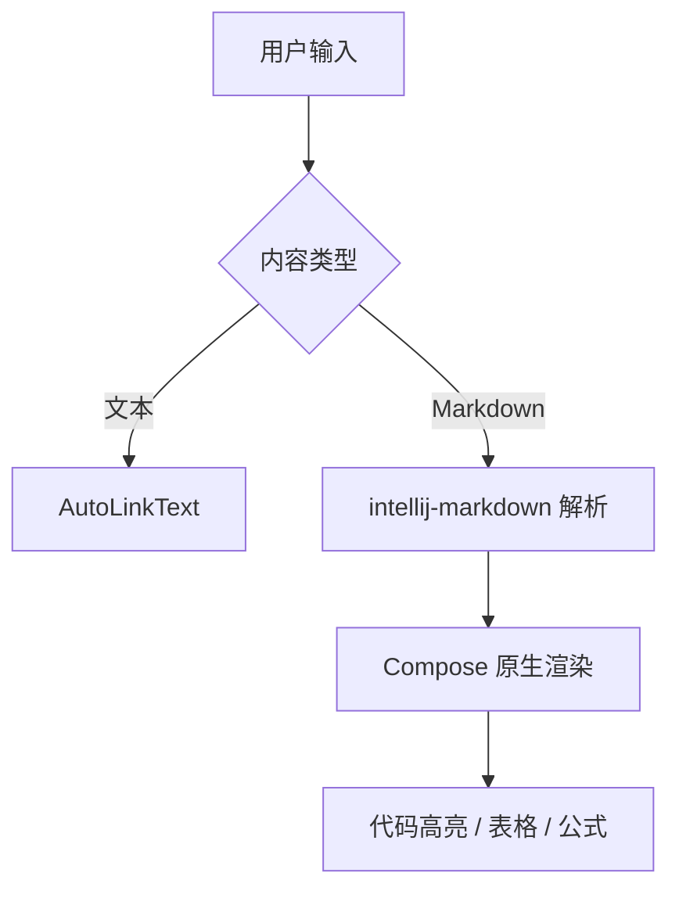
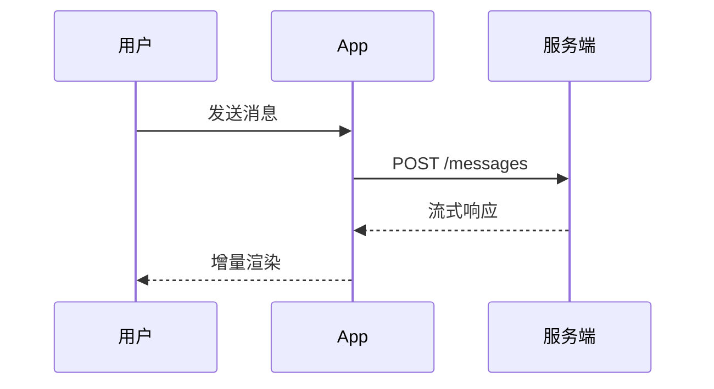
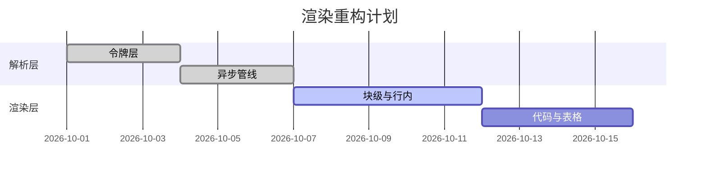

# LinkZone Markdown 全语法测试文档

> 本文档用于真机验证原生 Markdown 自绘渲染管线（intellij-markdown AST + Compose），覆盖全部 GFM 语法点与边界样例。**建议在聊天框中整段发送**，对照明暗两套主题逐一核对。

---

## 一、标题层级（h1–h6）

### 三级标题：列表与缩进

#### 四级标题：细节说明

##### 五级标题：补充

###### 六级标题：最末级

## 二、段落与行内样式

这是一段普通正文，用于检查 15sp 字号与 1.7 倍行高下的中文排版。中文逗号、顿号、句号与英文 punctuation, spacing 混排应自然。**加粗文本**、*斜体文本*、***加粗斜体***、~~删除线~~、以及 `行内代码` 应当各具样式且可辨识。

行内代码中文不应截断：`配置项`、`环境变量`、`获取用户信息`、`数据库连接字符串`、`这是一个相当长的中文行内代码样例用于测试药丸宽度边界`。混合内容：`UserRepository.findById(id: Long)` 与 `POST /api/v1/messages`。

键盘按键：按 <kbd>Ctrl</kbd> + <kbd>C</kbd> 复制，按 <kbd>Ctrl</kbd> + <kbd>V</kbd> 粘贴，按 <kbd>⌘</kbd> + <kbd>K</kbd> 打开命令面板。未知标签 <foo> 应安全降级不显示尖括号。

链接：访问 [LinkZone 官网](https://linkzone.example.com) 或 [GitHub 仓库](https://github.com/cjhsy666/linkzone-app)。自动链接：https://www.example.com 与邮箱 support@example.com 与电话 13800138000。


## 三、列表（含四级嵌套）

- 一级无序项 A
  - 二级无序项 A-1
    - 三级无序项 A-1-1
      - 四级无序项 A-1-1-1
- 一级无序项 B
  - 二级无序项 B-1

1. 有序项一
2. 有序项二
   1. 二级有序 2-1
   2. 二级有序 2-2
3. 有序项三

3. 从 3 开始的序号（起始序号正确性）
4. 应为 4
5. 应为 5

- [x] 已完成的任务项
- [ ] 未完成的任务项
- [ ] 第三项（含 `行内代码` 与 **加粗**）

## 四、引用与 GFM Alerts

> 普通引用块第一行。
>
> 引用块第二段，包含 **加粗** 与 `行内代码`。
>
> > 嵌套二级引用。
> >
> > > 嵌套三级引用，竖条应逐层变淡。

> [!NOTE]
> 这是一个 注意（NOTE）Alert，用于补充说明。

> [!TIP]
> 这是一个 提示（TIP）Alert，用于给出建议。

> [!IMPORTANT]
> 这是一个 重要（IMPORTANT）Alert，务必关注。

> [!WARNING]
> 这是一个 警告（WARNING）Alert，注意风险。

> [!CAUTION]
> 这是一个 危险（CAUTION）Alert，谨慎操作。

## 五、表格（对齐与边框）

| 左对齐 | 居中 | 右对齐 |
|:-------|:----:|-------:|
| 内容 A | 100  | 1,200 |
| 更长的中文单元格内容 | 20   | 3,400 |
| `代码单元格` | **加粗** | 5,600 |
| 混合：中文 + English + 123 | 🙂 | 7,800 |

## 六、代码块（8 种语言）

### Kotlin

```kotlin
data class MessageItem(
    val id: String,
    val content: String,
    val isSelf: Boolean,
    val segments: List<MessageSegment>? = null
)

fun MessageItem.displayText(): String =
    segments.orEmpty()
        .filter { it.type == "text" || it.type == "markdown" }
        .joinToString("\n") { it.get("content") }
        .ifBlank { content }
```

### Java

```java
public final class HttpClient {
    private final OkHttpClient client = new OkHttpClient.Builder()
        .connectTimeout(10, TimeUnit.SECONDS)
        .build();

    public String get(String url) throws IOException {
        Request request = new Request.Builder().url(url).build();
        try (Response response = client.newCall(request).execute()) {
            return response.body() != null ? response.body().string() : "";
        }
    }
}
```

### Python

```python
def merge_segments(segments: list[dict]) -> str:
    """将消息段合并为可读文本。"""
    parts = []
    for seg in segments:
        if seg.get("type") in ("text", "markdown"):
            text = seg.get("content", "").strip()
            if text:
                parts.append(text)
    return "\n".join(parts)
```

### JavaScript

```javascript
const debounce = (fn, wait = 200) => {
  let timer = null;
  return (...args) => {
    clearTimeout(timer);
    timer = setTimeout(() => fn(...args), wait);
  };
};

window.addEventListener('resize', debounce(() => {
  console.log('size changed', window.innerWidth);
}, 300));
```

### Bash（含超长块，> 50 行，验证折叠）

```bash
#!/usr/bin/env bash
set -euo pipefail

APP_NAME="linkzone"
BUILD_DIR="./linkzone-APP"
OUTPUT_DIR="./dist"
KEYSTORE="${KEYSTORE:-./release.jks}"
KEY_ALIAS="${KEY_ALIAS:-linkzone}"

log() { printf '[%s] %s\n' "$(date '+%H:%M:%S')" "$*"; }
die() { printf 'ERROR: %s\n' "$*" >&2; exit 1; }

clean() {
  log "清理构建产物"
  rm -rf "${BUILD_DIR}/build" "${OUTPUT_DIR}"
  mkdir -p "${OUTPUT_DIR}"
}

check_env() {
  command -v java >/dev/null 2>&1 || die "缺少 java"
  command -v gradle >/dev/null 2>&1 || die "缺少 gradle"
  [ -f "${KEYSTORE}" ] || die "缺少签名文件: ${KEYSTORE}"
  log "环境检查通过"
}

build_debug() {
  log "开始构建 Debug"
  (cd "${BUILD_DIR}" && ./gradlew assembleDebug --no-daemon)
  local apk="${BUILD_DIR}/build/outputs/apk/debug/app-debug.apk"
  [ -f "${apk}" ] || die "未产出 APK"
  cp "${apk}" "${OUTPUT_DIR}/LinkZoneApp-debug.apk"
}

build_release() {
  log "开始构建 Release"
  (cd "${BUILD_DIR}" && ./gradlew assembleRelease \
      -Pandroid.injected.signing.store.file="${KEYSTORE}" \
      -Pandroid.injected.signing.store.password="${STORE_PASS:-}" \
      -Pandroid.injected.signing.key.alias="${KEY_ALIAS}" \
      -Pandroid.injected.signing.key.password="${KEY_PASS:-}")
  local apk="${BUILD_DIR}/build/outputs/apk/release/app-release.apk"
  [ -f "${apk}" ] || die "未产出 Release APK"
  cp "${apk}" "${OUTPUT_DIR}/LinkZoneApp-release.apk"
}

upload() {
  local target="$1"
  log "上传 ${target}"
  curl -fsSL -X POST https://ci.example.com/upload \
    -H "Content-Type: application/octet-stream" \
    --data-binary "@${target}" \
    || die "上传失败"
}

main() {
  log "开始流水线: ${APP_NAME}"
  clean
  check_env
  build_debug
  build_release
  upload "${OUTPUT_DIR}/LinkZoneApp-release.apk"
  log "全部完成 ✅"
}

main "$@"
```

### SQL

```sql
SELECT u.id,
       u.nickname,
       COUNT(m.id) AS message_count,
       MAX(m.created_at) AS last_active
  FROM users u
  LEFT JOIN messages m ON m.user_id = u.id
 WHERE u.deleted_at IS NULL
 GROUP BY u.id, u.nickname
HAVING COUNT(m.id) > 0
 ORDER BY last_active DESC
 LIMIT 20;
```

### JSON

```json
{
  "conversationId": "local-conv-3f8a2c",
  "messages": [
    { "id": "m1", "role": "user", "content": "你好" },
    { "id": "m2", "role": "assistant", "content": "你好！有什么可以帮你的？" }
  ],
  "meta": { "model": "deepseek-v4", "tokens": 128 }
}
```

### XML

```xml
<resources>
    <string name="app_name">LinkZone</string>
    <color name="brand_primary">#5B6BF0</color>
    <style name="AppTheme" parent="Theme.Material3.DayNight">
        <item name="android:statusBarColor">@android:color/transparent</item>
    </style>
</resources>
```

## 七、数学公式（行内与块级）

行内公式：质能方程 $E = mc^2$，欧拉恒等式 $e^{i\pi} + 1 = 0$，以及带下标的 $a_{n} = a_{n-1} + d$。

块级公式：

$$
\int_{-\infty}^{\infty} e^{-x^2}\,dx = \sqrt{\pi}
$$

$$
\begin{pmatrix} a & b \\ c & d \end{pmatrix}
\begin{pmatrix} x \\ y \end{pmatrix}
=
\begin{pmatrix} ax + by \\ cx + dy \end{pmatrix}
$$

## 八、Mermaid 图表（三图）

图形（Graph）：



时序图（Sequence）：



甘特图（Gantt）：



## 九、脚注

正文引用了第一个脚注[^note1]，也引用了第二个脚注[^note2]，并且可以重复引用同一个[^note1]。未定义的引用[^undefined]应原样显示为文本。

[^note1]: 这是第一个脚注的定义，支持**加粗**与 `行内代码`。
[^note2]: 这是第二个脚注，包含一个 [链接](https://example.com)。

---

## 十、分割线

上方为分割线，用于分隔大段落。

***

## 十一、畸形与边界样例

未闭合的强调：**这里是加粗没闭合

未闭合的行内代码：`这里没有闭合

未闭合的代码围栏（下一行为开栏，本行仅作文本描述）：

未闭合的表格（缺分隔行）：

| 列A | 列B |
| 只有表头 | 没有分隔 |

这是一个非常长的、没有任何换行的字符串，用于验证行内文本的自动换行与截断行为不会导致崩溃或溢出：aaaaaaaaaaaaaaaaaaaaaaaaaaaaaaaaaaaaaaaaaaaaaaaaaaaaaaaaaaaaaaaaaaaaaaaaaaaaaaaaaaaaaaaaaaaaaaaaaaaaaaaaaaaaaaaaaaaaaaaaaaaaaaaaaaaaaaaaaaaaaaaaaaaaaaaaaaaaaaaaaaaaaaaaaaaaaaaaaaaaaaaaaaaaaaaaaaaaaaaaaaaaaaaaaaaaaaaaaaaaaaaaaaaaaaaaaaaaaaaa。

> [!NOTE]
此 Alert 缺少引用前缀（畸形），应安全降级。

结束语：以上覆盖完毕，感谢核对。
